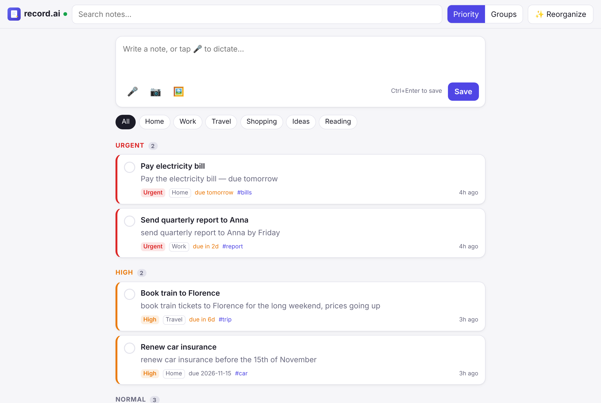
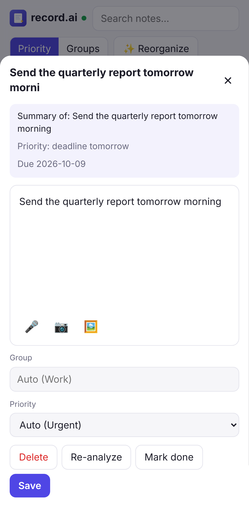

# record.ai

Notes you **type, dictate, or photograph**. They sync across your phone, your computer, and the web, and **AI organizes them for you** (Claude online, or a free model running on your own computer): it gives each note a title, a priority (urgent, high, normal, low), a topic group, tags and a due date.

<p>
  
  
</p>

## What it does

- **Write** notes, or **dictate** them with 🎤 (speech-to-text in the browser).
- **Photos**: pick images 🖼️, paste or drag them in, or take pictures with the **camera** 📷. Claude looks at the photos too (receipts, whiteboards, documents).
- **Lists**: start lines with `- ` and they become a checklist (shopping, a project's tasks, kids' activities). Tick items right from the card; open the note to add items or set each one's priority. Open items show first, most urgent on top.
- **Automatic organization**: each new or edited note is sent to Claude, which assigns a title, summary, **priority**, **group**, tags and a due date. It reuses your existing groups so the list stays tidy.
- **✨ Reorganize**: Claude reviews all open notes together, merges similar groups and re-ranks priorities against today's date. This also runs on its own after every 20 newly organized notes.
- **Two views**: *Priority* (Urgent → Low) and *Groups*. There's also search, group filter chips, and a "done" checkbox.
- **Your choices win**: open a note to set its group or priority yourself (📌). The AI won't change it until you set it back to *Auto*.
- **Same notes on every device**: changes show up live on your other devices.
- **Works offline**: notes and photos are saved on the device first and upload when you're back online.
- **Installable** on iPhone, Android, Windows, macOS, Linux and ChromeOS. It's one app (a Progressive Web App), so there are no app stores to deal with.

## Run it on a Mac (free, easiest)

1. Install **Node.js** (LTS) from [nodejs.org](https://nodejs.org/).
2. Download this project as a ZIP and unzip it into your **Home** folder. Don't use iCloud Drive: iCloud syncing can damage the notes database.
3. Double-click **`Start record.ai.command`**. The first time, macOS blocks it. Click **Done**, then go to System Settings → Privacy & Security → **Open Anyway**.
   It installs what it needs, asks which AI to use, starts the server and opens the app. On the first visit, create your account.
   Keep the Terminal window open while you use the app. Close it to stop.
4. **Phone:** install [Tailscale](https://tailscale.com/download) on the Mac and the phone, signed in to the same account, then start record.ai again.
   The Terminal window shows an `https://….ts.net` address to open on your phone.

**Which AI?** The first start asks you. Double-click **`Change AI.command`** at any time to switch:

| Choice | Cost | Notes |
|---|---|---|
| **Free on this Mac** | Free | Runs privately with [Ollama](https://ollama.com/download), which you install once. The first start downloads the model (`gemma3:4b`, about 3 GB). Less clever than Claude. |
| **Claude online (cheap)** | A few cents per 100 notes | Uses Claude Haiku 5.5. Needs an Anthropic API key with credit (console.anthropic.com → Plans & Billing). |
| **No AI** | Free | Notes are saved but not sorted. |

When you switch, notes the AI couldn't sort earlier are sorted automatically.
Your notes live in the `data` folder. Settings are in `.env`.

## Run it locally (any OS)

Requires Node.js 22.13 or newer.

```bash
npm install
cp .env.example .env      # then edit: ANTHROPIC_API_KEY
npm start                 # → http://localhost:3000
```

Get an API key at <https://console.anthropic.com/>. Without a key the app still works and syncs, but notes go into "Inbox" with a basic title and aren't organized.

## Put it online (so your phone can reach it)

Your devices all talk to one small server that stores the notes. Camera, microphone and "install app" only work over **HTTPS**, so host it somewhere that gives you HTTPS:

- **Fly.io (cheapest, about $3.50/month)**: `fly.toml` is ready (Frankfurt, always on, 1 GB disk with daily snapshots). Step by step, including moving your notes from your Mac: [docs/DEPLOY_FLY.md](docs/DEPLOY_FLY.md).
- **Render (no Terminal needed, about $7.25/month)**: push this repo to GitHub, then on render.com choose **New → Blueprint** and pick the repo. `render.yaml` sets up the server and a persistent disk. Enter `ANTHROPIC_API_KEY` when it asks, then open the site and create your account right away.
- **Any Docker host** (Fly.io, Railway, a VPS…):
  ```bash
  docker build -t record-ai .
  docker run -p 3000:3000 -v record-ai-data:/data \
    -e ANTHROPIC_API_KEY=... record-ai
  ```
  Put HTTPS in front of it (most hosts do this for you, or use Caddy or a Cloudflare Tunnel).
- **Home computer only**: `npm start`, then reach it over HTTPS with [Tailscale](https://tailscale.com/kb/1312/serve) (`tailscale serve 3000`) or a Cloudflare Tunnel.

**Create your account right after the server starts.** The first account becomes the owner; after that, nobody else can sign up unless you allow it (see *Accounts* below).

## iPhone and Android apps

There are **native phone apps** for iPhone ([`ios/`](ios/)) and Android ([`android/`](android/)). They use the same server and account as the web app, have dictation, camera and photos, work offline, and stay in sync live: an edit on one device shows on the others within a moment.

- iPhone: see [ios/README.md](ios/README.md) (needs a Mac with Xcode).
- Android: see [android/README.md](android/README.md) (download the app from GitHub, or build it with Android Studio).

## Install it on your devices

Open your server's URL, log in, then:

| Device | How |
|---|---|
| iPhone / iPad | Safari → Share → **Add to Home Screen** |
| Android | Chrome → ⋮ → **Install app**. Afterwards you can share text from other apps straight into record.ai. |
| Windows / macOS / Linux | Chrome or Edge → install icon in the address bar (or ⋮ → **Install record.ai**) |
| Any browser | Just use the website |

## Accounts

- **Log in with email and password, or "Continue with" Google, Apple, Microsoft, Facebook, LinkedIn, X or GitHub** once you've set them up ([docs/SOCIAL_LOGIN.md](docs/SOCIAL_LOGIN.md)). One account can have several of these; connect more under your initials → **Sign-in options**.
- **The first account** created on a server is its owner. It also receives any notes saved before accounts existed.
- **Everyone has their own private notes and photos.** Nobody can see anyone else's.
- **More accounts:** set `ALLOW_SIGNUP=true` (anyone can sign up) or `SIGNUP_CODE=…` (sign up with an invite code), then restart.
- **In the app** (tap your initials, top right): change your password, log out, or log out all other devices. Changing the password also logs out the other devices.
- **Security:** passwords are stored hashed with scrypt, session tokens are stored hashed, and repeated wrong passwords are slowed down (10 tries per 15 minutes). Logging out removes your notes from that device.
- **Forgot your password?** On the server, run `npm run reset-password -- you@example.com "new password"`.

## Configuration

| Variable | Default | Meaning |
|---|---|---|
| `PUBLIC_URL` | *(the address in the browser)* | The HTTPS address people use, e.g. `https://notes.example.com`. Needed for "Continue with Google" etc. |
| `GOOGLE_CLIENT_ID`, `GOOGLE_CLIENT_SECRET`, … | *(none)* | Turn on "Continue with Google / Apple / Microsoft / Facebook / LinkedIn / X / GitHub". Step by step: [docs/SOCIAL_LOGIN.md](docs/SOCIAL_LOGIN.md). |
| `ALLOW_SIGNUP` | `false` | `true` lets anyone who can reach the server create an account. |
| `SIGNUP_CODE` | *(none)* | Lets people create an account only with this invite code. |
| `AI_PROVIDER` | `anthropic` | `anthropic` (Claude), `ollama` (free local AI), or `none`. |
| `ANTHROPIC_API_KEY` | *(none)* | Needed for Claude. |
| `CLAUDE_MODEL` | `claude-opus-5-5` | Claude model to use (`claude-haiku-5-5` is the cheap one). |
| `OLLAMA_MODEL` | `gemma3:4b` | Local model. It must handle images; `qwen2.5vl:7b` is smarter but needs 16 GB RAM. |
| `OLLAMA_URL` | `http://127.0.0.1:11434` | Where Ollama runs. |
| `REORGANIZE_EVERY` | `20` | Run a full reorganize after this many newly organized notes. |
| `PORT` | `3000` | HTTP port. |
| `TRUST_PROXY` | `loopback` | Which proxy to believe about visitors' addresses. Behind a host's proxy (Fly.io, Render) set `1`, or one person's wrong passwords slow down everyone. |
| `DATA_DIR` | `./data` | Where the SQLite database and photos are stored. **Back this up.** |

## How it works

```
 phone ─┐                      ┌─ SQLite (notes)
 laptop ┼─ HTTPS ─ Node server ┼─ data/images (photos)
 web ───┘   ▲  live updates    └─ Claude API (organize)
            └─ (Server-Sent Events)
```

- `ios/`: the native iPhone app (SwiftUI). `android/`: the native Android app (Kotlin, Jetpack Compose). Both talk to the same API, using a token instead of a cookie.
- `public/`: the app (plain HTML/CSS/JS, no build step). `local.js` stores notes in IndexedDB, queues changes in an outbox, and syncs. `sw.js` lets the app open offline.
- `server/`: Express API. `db.js` is storage (Node's built-in SQLite). `organizer.js` holds the Claude prompts. It uses structured outputs, so replies always match the schema, and server-side refusal fallback.
- Sync: each device sends all its waiting edits and fetches what changed in **one** request, JSON is gzip-compressed, and lists use small photo previews. Every change gets an increasing revision number. Devices fetch "everything since revision N" and get live pushes. If two devices edit the same note, the most recent edit wins. The AI writes only its own fields (title, AI group and priority…), so it never overwrites your text or your choices.

## Development

```bash
npm run dev            # restart on changes
npm test               # server, accounts, AI, scripts and iPhone-protocol tests
npm run e2e            # browser test: two devices, sign-up, sync, photos, camera, offline, logout
npm run check:swift    # syntax check of the iPhone app
cd android && ./gradlew :core:test   # Android sync tests (Java 17)
npm run coverage       # tests with a coverage table
```

- [docs/DEVELOPMENT.md](docs/DEVELOPMENT.md): how the parts fit, the sync rules, and what each test covers (and doesn't).
- [docs/API.md](docs/API.md): the server API used by the web, iPhone and Android apps.

GitHub runs every test on each push.

## Known limitations

- **Dictation** uses the browser's speech recognition: Chrome, Edge, Safari (including iPhone) and Android. Firefox doesn't support it, so use your keyboard's 🎤 key instead.
- There is no email, so a forgotten password is reset on the server: `npm run reset-password -- you@example.com "new password"`.
- Photos are shrunk to 1600px before upload to keep sync and AI calls fast.

## License

[MIT](LICENSE): free to use, change and share. Please keep the copyright notice.
